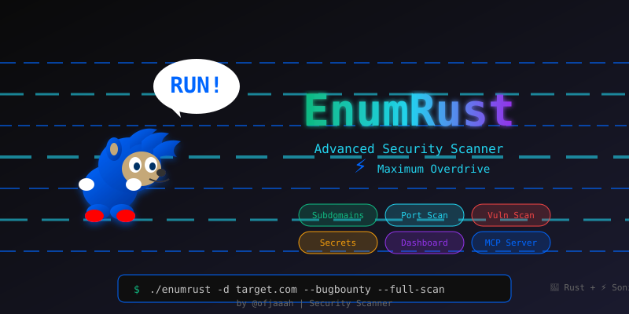

# 🛡️ EnumRust - Advanced Security Scanner

<div align="center">



**A comprehensive Rust-based security enumeration tool with real-time dashboard**

[](https://www.rust-lang.org/)
[](LICENSE)
[](DOCKER.md)
[](https://github.com/ofjaaah)

</div>

---

## 🎯 Features

### Core Capabilities
- 🕵️ **Subdomain Enumeration** - haktrails, subfinder, certificate transparency
- 🌐 **DNS Resolution** - Fast IP resolution with dnsx
- ⚡ **Port Scanning** - masscan for speed, httpx for validation
- 🔍 **Web Crawling** - JavaScript analysis, endpoint discovery
- 🚨 **Vulnerability Scanning** - Nuclei integration
- 🗄️ **Infrastructure Mode** - Network scanning with IP ranges
- 📊 **Real-time Dashboard** - Web UI with live progress tracking

### 🎯 Bug Bounty Mode (NEW!)
- 🔍 **Admin Panel Discovery** - Scans 15 ports & 80+ admin paths
- 🔑 **Default Credential Testing** - Tests 40+ common username/password combinations
- 🔔 **Discord Notifications** - Real-time alerts for critical findings
- 🎯 **Multi-Auth Support** - Form-based, Basic Auth, API JSON
- 💥 **Instant Alerts** - Valid credentials, secrets, vulnerabilities
- 📊 **Detailed Reports** - JSON + TXT outputs for bug submissions

👉 **[Full Bug Bounty Guide](BUGBOUNTY_MODE.md)**

---

## 🆕 What's New

### IIS Short Filename Scanner (Shortscan)
- **Auto IIS Detection** - Automatically detects Microsoft IIS servers via `Server` header during scans
- **8.3 Filename Bruteforce** - Exploits the Windows tilde (`~`) vulnerability to discover hidden files and directories
- **[shortscan](https://github.com/bitquark/shortscan) Integration** - Runs as STAGE 7.7 against up to 10 IIS targets
- **JSON Output** - Results saved to `shortscan_results.json` with structured findings
- **Skip Flag** - Use `--no-shortscan` to disable IIS scanning
- **Install** - `go install github.com/bitquark/shortscan/cmd/shortscan@latest`

### WordPress Vulnerability Scanner (WPScan)
- **Auto WordPress Detection** - Identifies WordPress sites from admin panels, `/wp-content/`, `/wp-json/`, etc.
- **Docker-based WPScan** - Runs `wpscanteam/wpscan` via Docker for deep vulnerability analysis
- **Plugin & Theme Enumeration** - Detects vulnerable plugins, outdated themes, and exposed users
- **AI False Positive Filter** - Ollama validates WPScan findings and removes false positives
- **API Token Support** - Use `--wpscan-token` for enhanced vulnerability database access
- **Skip Flag** - Use `--no-wpscan` to disable WordPress scanning

### Ollama AI Integration
- **Auto-Detection** - Silently detects Ollama at `localhost:11434` on scan start
- **All-Stage Filtering** - AI validates secrets, nuclei findings, admin panels, credentials, and more
- **Executive Summary** - Generates `ai_executive_summary.txt` with AI-powered analysis
- **Response Caching** - Up to 5000 cached entries to avoid redundant queries
- **Custom Model** - Configure via `OLLAMA_MODEL` env var (default: `llama3`)

### Enhanced HTML Report Generator
- **Interactive Dashboard** - Full HTML report with charts, filtering, and severity breakdown
- **All Findings Integrated** - Secrets, vulnerabilities, admin panels, WordPress, IIS findings in one report
- **Export Ready** - Professional format suitable for bug bounty submissions

---

## Recent Improvements (v2.3.0)

### Advanced Secrets Scanner
- **70+ Token Patterns** - GitHub (PAT, OAuth, App), AWS, GCP, Azure, Vercel, Stripe, Twilio, SendGrid, Slack, Discord, and more
- **Token Validation** - Automatic validation against real APIs to confirm if secrets are active
- **Code Context** - Shows exact line number and code snippet where secret was found
- **Remediation Guidance** - Provides specific steps to fix each type of exposed secret

### Cloud Storage Security Testing
- **S3 Bucket Testing** - Tests for anonymous read/write/list permissions
- **GCS & Azure Blob** - Multi-cloud storage exposure detection
- **Risk Level Assessment** - Automatic severity classification

### IP Validator & CDN Filter
- **CDN Detection** - Automatically filters out IPs from Cloudflare, Akamai, Fastly, AWS CloudFront, Google Cloud CDN, Azure CDN, Incapsula
- **Smart IP Validation** - Removes invalid IPs and duplicates from scan results
- **False Positive Reduction** - Only scans real target infrastructure, not shared CDN IPs

### Dependency Confusion Scanner
- **NPM Package Detection** - Extracts packages from require(), import statements
- **Public Registry Validation** - Checks if internal packages exist on public npm registry
- **Dependency Confusion Alert** - Identifies potential supply chain attack vectors

### Enhanced JavaScript Crawler
- **Multi-source Collection** - Aggregates JS from URLFinder, HTTP200, DOM parsing
- **Deep Secret Extraction** - Analyzes JavaScript content for hardcoded credentials
- **API Endpoint Discovery** - Extracts REST/GraphQL endpoints from JS code

### Admin Panel Discovery
- **15 Port Scanning** - Covers ports 80, 443, 8080, 8443, 8000, 3000, 5000, 9000, 8888, 8088, 8081, 9090, 3001, 4200, 5001
- **80+ Admin Paths** - WordPress, Joomla, Laravel, Django, phpMyAdmin, and more
- **Smart Fingerprinting** - Identifies CMS type from response content

### Credential Testing Engine
- **40+ Default Credentials** - Common admin/password combinations
- **Multi-Auth Support** - Form-based, HTTP Basic Auth, API JSON authentication
- **Rate Limiting** - Built-in delays to avoid account lockouts

---

## 🚀 Quick Start

### 1. One-Line Auto Install (Recommended)

```bash
git clone https://github.com/KingOfBugbounty/enumrust.git && cd enumrust && sudo bash install.sh
```

This will automatically:
- Install Rust and Go toolchains (if missing)
- Build `enumrust` and copy to `/usr/local/bin/`
- Install all 21 security tools (httpx, nuclei, shortscan, etc.)
- Configure PATH in `.bashrc`, `.zshrc`, `.profile`
- Update Nuclei templates

After install, open a new terminal or run `source ~/.bashrc`, then:
```bash
enumrust --check-tools       # verify all tools
enumrust -d target.com       # start scanning
```

### 1b. Manual Build (Alternative)

```bash
# Clone repository
git clone https://github.com/KingOfBugbounty/enumrust.git
cd enumrust

# Build release version
cargo build --release

## Installation

### Clone via GitHub Token (Private Repository)

To clone this repository, you need a GitHub Personal Access Token with `repo` scope.

1. **Generate your token** at [GitHub Settings > Developer settings > Personal access tokens](https://github.com/settings/tokens)

2. **Clone using HTTPS + Token:**

```bash
git clone https://$YOUR_GITHUB_TOKEN@github.com/tools-ofjaaah/enumrust.git
```

Or set the token as an environment variable:

```bash
export YOUR_GITHUB_TOKEN="ghp_xxxxxxxxxxxxxxxxxxxx"
git clone https://${YOUR_GITHUB_TOKEN}@github.com/tools-ofjaaah/enumrust.git
cd enumrust
```

3. **Alternative — SSH clone (if you have SSH keys configured):**

```bash
git clone git@github.com:tools-ofjaaah/enumrust.git
```

> **Repository URL:** `https://github.com/tools-ofjaaah/enumrust.git`
### 2. Basic Scan

```bash
# Domain enumeration with full scan
./target/release/enumrust -d example.com --subfinder --full-scan

# Domain enumeration (basic)
./target/release/enumrust -d example.com --subfinder
```

### 3. Dashboard Mode

```bash
# Start dashboard on default port 8080
./target/release/enumrust --dashboard

# Start dashboard on custom port
./target/release/enumrust --dashboard --dashboard-port 3000

# Run scan with dashboard monitoring
./target/release/enumrust -d target.com --subfinder --full-scan --dashboard
```

**First Access Setup:**
```
🚀 Dashboard server starting on http://0.0.0.0:8080
📊 Access the dashboard and complete the initial setup
   Setup Code: <random_16_char_code>
```

1. Open `http://localhost:8080` in your browser
2. Use the **Setup Code** displayed in terminal (generated randomly each startup)
3. Create your own username and password
4. Login and start monitoring your scans

---

## 🐳 Docker Installation

Run EnumRust with **all 21 tools pre-installed** using Docker - zero configuration required.

```bash
# Build
docker build -t enumrust .

# Verify all 21 tools
docker run --rm enumrust --check-tools

# Run a scan
docker run --rm --privileged \
  -v $(pwd)/results:/results \
  enumrust -d target.com --subfinder --full-scan

# Dashboard mode
docker run --rm --privileged \
  -p 8080:8080 \
  -v $(pwd)/results:/results \
  enumrust -d target.com --dashboard --full-scan
```

> **Note:** `--privileged` is required for masscan (raw socket access). Omit it if you don't need port scanning.

👉 **[Full Docker Guide](DOCKER.md)** - Complete instructions, examples, volume mounts, troubleshooting, and more

---

## 📊 Dashboard Features

### Real-time Monitoring
- **Progress Bar** - Animated, shows current scan phase
- **Event Stream** - Live feed of tool execution
- **Statistics Cards** - Vulnerability counts by severity

### File Explorer
- **Two-Panel Layout** - File list + content viewer
- **Syntax Highlighting** - Terminal-style display
- **Domain Filtering** - Select specific target to view

### Vulnerability Management
- **Severity Filters** - Critical, High, Medium, Low
- **Detailed View** - Template ID, host, description
- **Export Options** - JSON data for reporting

### Security
- **Random Credentials** - Setup code generated at each startup
- **JWT Authentication** - Secure session management
- **No Hardcoded Secrets** - All credentials created by user

---

## 📖 Usage Examples

### Bug Bounty Mode 🎯
```bash
# Bug bounty scan with Discord notifications
./target/release/enumrust -d target.com \
  --bugbounty \
  --discord-webhook "https://discord.com/api/webhooks/YOUR_WEBHOOK"

# Aggressive bug bounty scan
./target/release/enumrust -d target.com \
  --bugbounty \
  --full-scan \
  --workers 20 \
  --discord-webhook "https://discord.com/api/webhooks/YOUR_WEBHOOK"
```

**What it does:**
- ✅ Discovers admin panels on 15 different ports
- ✅ Tests 40+ default credentials automatically
- ✅ Sends Discord alerts for valid credentials found
- ✅ Notifies about critical vulnerabilities & secrets
- ✅ Generates detailed reports for bug submissions

👉 **See [BUGBOUNTY_MODE.md](BUGBOUNTY_MODE.md) for complete guide**

### Domain Reconnaissance
```bash
# Full enumeration with all sources
./target/release/enumrust -d target.com --full-scan

# Quick scan with specific tools
./target/release/enumrust -d target.com --subfinder
```

### Infrastructure Scanning
```bash
# Single IP
./target/release/enumrust --infraestrutura --ip-range 192.168.1.100

# CIDR notation
./target/release/enumrust --infraestrutura --ip-range 192.168.1.0/24

# IP range
./target/release/enumrust --infraestrutura --ip-range 192.168.1.1-192.168.1.254

# Comma-separated IPs
./target/release/enumrust --infraestrutura --ip-range 192.168.1.1,192.168.1.5,192.168.1.10

# From file
./target/release/enumrust -f targets.txt --full-scan
```

### Advanced Options
```bash
# Full IP scan with directory fuzzing
./target/release/enumrust -d target.com \
  --ip-scan \
  --ip-full-scan
```

---

## 📂 Output Structure

After scanning `example.com`, results are saved in:

```
example.com/
├── subdomains.txt          # Discovered subdomains
├── ips.txt                 # Resolved IP addresses
├── http200.txt             # Active HTTP(S) hosts
├── masscan.txt             # Port scan results
├── ports.txt               # Validated open ports
├── nuclei.txt              # Vulnerability findings
├── urls.txt                # Discovered URLs
├── js_endpoints.txt        # JavaScript endpoints
├── js_secrets.txt          # Potential secrets in JS
├── s3.txt                  # S3 bucket URLs
├── ferox_200_only.txt      # Directory bruteforce results
├── wpscan_results.json     # WordPress vulnerability findings
├── shortscan_results.json  # IIS short filename findings
├── ai_executive_summary.txt # AI-generated executive summary
├── all_results.txt         # Consolidated report
├── report.html             # Interactive HTML report
├── current_status.json     # Scan status
├── progress.jsonl          # Real-time progress log
└── metrics.json            # Performance metrics
```

---

## 🛠️ Tool Installation

### Automatic Installation (Recommended)

EnumRust includes built-in tool management. Install all required tools with a single command:

```bash
# Install ALL required tools automatically
./target/release/enumrust --install-tools
```

This will:
- ✅ Install Go if not present
- ✅ Install all 19 security tools
- ✅ Configure PATH automatically in `.bashrc`, `.zshrc`, `.profile`
- ✅ Update Nuclei templates
- ✅ Skip already installed tools

### Check Tool Status

Verify which tools are installed:

```bash
./target/release/enumrust --check-tools
```

Example output:
```
━━━━━━━━━━━━━━━━━━━━━━━━━━━━━━━━━━━━━━━━━━━━━━━━━━━━━━━━━━━
  CORE TOOLS (Required)
━━━━━━━━━━━━━━━━━━━━━━━━━━━━━━━━━━━━━━━━━━━━━━━━━━━━━━━━━━━
  ✓ httpx           - HTTP probing and validation
  ✓ dnsx            - DNS resolution and validation
  ✓ nuclei          - Vulnerability scanner
  ✓ masscan         - Port scanner (requires sudo)

  OPTIONAL TOOLS
━━━━━━━━━━━━━━━━━━━━━━━━━━━━━━━━━━━━━━━━━━━━━━━━━━━━━━━━━━━
  ✓ subfinder       - Passive subdomain discovery
  ✓ haktrails       - SecurityTrails subdomain discovery
  ✓ tlsx            - TLS/SSL certificate analysis
  ✓ ffuf            - Fast web fuzzer
  ✓ feroxbuster     - Recursive directory brute-forcer
  ✓ trufflehog      - Secret scanner
  ...
```

### Required Tools List

| Tool | Category | Description |
|------|----------|-------------|
| **httpx** | Core | HTTP probing and validation |
| **dnsx** | Core | DNS resolution and validation |
| **nuclei** | Core | Vulnerability scanner |
| **masscan** | Core | Fast port scanner (requires sudo) |
| subfinder | Discovery | Passive subdomain enumeration |
| haktrails | Discovery | SecurityTrails integration |
| tlsx | Discovery | TLS/SSL certificate analysis |
| ffuf | Fuzzing | Fast web fuzzer |
| feroxbuster | Fuzzing | Recursive directory brute-forcer |
| trufflehog | Secrets | Secret/credential scanner |
| anew | Utils | Append unique lines to files |
| jq | Utils | JSON processor |
| whois | Utils | Domain registration lookup |
| tmux | Utils | Terminal multiplexer |
| hakrawler | Crawling | Web crawler for URL discovery |
| urlfinder | Crawling | Passive URL discovery |
| katana | Crawling | Fast web crawler |
| gau | Crawling | Fetch URLs from web archives |
| waybackurls | Crawling | Fetch URLs from Wayback Machine |
| shortscan | IIS | IIS short filename (8.3) scanner |
| docker | WPScan | WordPress vulnerability scanner (via Docker) |

### Manual Installation (Alternative)

If you prefer manual installation:

```bash
# Install Go first (required for most tools)
apt-get install -y golang-go

# Core tools
go install -v github.com/projectdiscovery/httpx/cmd/httpx@latest
go install -v github.com/projectdiscovery/dnsx/cmd/dnsx@latest
go install -v github.com/projectdiscovery/nuclei/v3/cmd/nuclei@latest
apt-get install -y masscan

# Discovery tools
go install -v github.com/projectdiscovery/subfinder/v2/cmd/subfinder@latest
go install -v github.com/hakluke/haktrails@latest
go install -v github.com/projectdiscovery/tlsx/cmd/tlsx@latest

# Fuzzing tools
go install -v github.com/ffuf/ffuf/v2@latest
cargo install feroxbuster  # or: apt-get install feroxbuster

# Crawling tools
go install -v github.com/hakluke/hakrawler@latest
go install -v github.com/projectdiscovery/urlfinder/cmd/urlfinder@latest
go install -v github.com/projectdiscovery/katana/cmd/katana@latest
go install -v github.com/lc/gau/v2/cmd/gau@latest
go install -v github.com/tomnomnom/waybackurls@latest

# Utils
go install -v github.com/tomnomnom/anew@latest
go install -v github.com/trufflesecurity/trufflehog/v3@latest
apt-get install -y jq whois tmux

# IIS Scanner
go install github.com/bitquark/shortscan/cmd/shortscan@latest

# WordPress Scanner (Docker-based)
curl -fsSL https://get.docker.com | sh && docker pull wpscanteam/wpscan

# Add Go binaries to PATH
echo 'export PATH="$PATH:$HOME/go/bin"' >> ~/.bashrc
source ~/.bashrc

# Update Nuclei templates
nuclei -ut
```

---

## 📊 Performance

- **Concurrent Scanning** - Parallel tool execution
- **Async I/O** - Non-blocking operations
- **Resource Management** - Automatic cleanup
- **Timeout Handling** - Prevents hanging scans

**Typical Scan Times:**
- Small domain (< 10 subdomains): 2-5 minutes
- Medium domain (10-50 subdomains): 5-15 minutes
- Large domain (> 50 subdomains): 15-30 minutes

---

## 🔒 Security

- **Path Validation** - Prevents directory traversal
- **Input Sanitization** - Command injection protection

---

## 🤝 Contributing

Contributions are welcome! Please:
1. Fork the repository
2. Create a feature branch
3. Submit a pull request

---

## 📄 License

MIT License - see [LICENSE](LICENSE) for details.

---

## 👤 Author

**OFJAAAH**

- GitHub: [@ofjaaah](https://github.com/ofjaaah)

---

<div align="center">

**Made with ❤️ and Rust 🦀**

</div>
